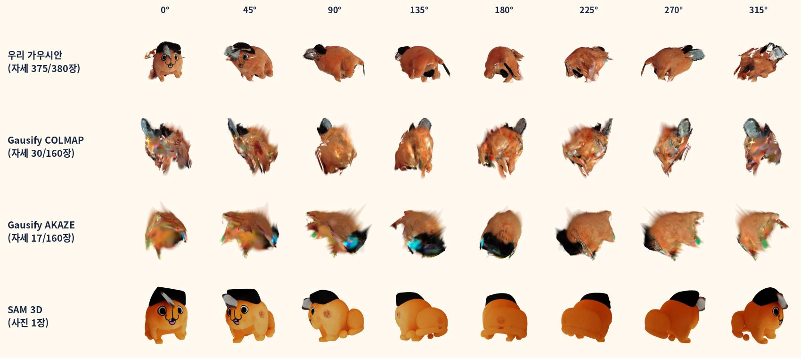

# goodmorning-3d

굿즈를 손에 들고 한 바퀴 돌려 찍은 영상 하나로 3D 에셋(3D 가우시안 스플래팅)을 만들고, 원본 영상과 같은 시점에서 대조해 보는 저장소다.
굿즈 앱 [goodmorning](https://github.com/bloodmoon3929/goodmorning)의 '내 방' 3D 부분(에셋 · 만드는 코드)을 뷰어와 함께 따로 모았다.

- 뷰어: https://bloodmoon3929.github.io/goodmorning-3d/
- 시험용 굿즈: 포치타 인형 (팀이 직접 찍은 영상)



## 들어 있는 것

```
capture/pochita/20261123_091242.mp4   원본 촬영 영상 (15.8초, HEVC)
assets/pochita/
  gs.ply                 이 저장소 파이프라인 결과 — 3D 가우시안 스플래팅 (SfM 좌표, 11.0만 개, SH 3차)
  sam3d.ply              SAM 3D Objects 결과 — 첫 프레임 사진 1장 (입력 카메라 좌표, 87.8만 개)
  gausify_colmap.ply     Gausify Orbit 결과 — COLMAP 자세 (5.6만 개)
  gausify_akaze.ply      Gausify Orbit 결과 — AKAZE 자세 (2.9만 개)
  sfm/                   COLMAP 모델 (영상 프레임 375장의 카메라 · 점) — gs.ply와 같은 좌표
  sam3d_input/           SAM 3D에 넣은 사진과 SAM 3 마스크
  turntable/<방법>/       같은 렌더러로 5°씩 돌린 72장 (배경 투명 WebP)
  compare.jpg            위 비교 그림
  methods.json           방법 목록 · 설명 (뷰어 데이터의 원본)
pipeline/                만드는 코드 (Python, uv) — pipeline/README.md
viewer/                  웹 뷰어 (three.js + Spark, 빌드 없음)
  data/pochita/          export_viewer.py가 만든 manifest.json · 웹용 영상(H.264) · sam3d.splat
serve.py                 뷰어를 이 PC에서 여는 정적 서버 (영상 seek에 필요한 Range 지원)
```

.ply는 3D 가우시안 스플래팅 표준 형식이라 [SuperSplat](https://superspl.at/editor) 같은 다른 뷰어에서도 열린다.

## 뷰어

원본 영상과 3D를 나란히 또는 겹쳐 놓고, 같은 시점에서 본다.

|방법|3D 카메라|
|--|--|
|가우시안 스플래팅 (이 저장소)|영상 카메라 따라가기: 영상 시간에 맞춰 SfM이 구한 그 프레임의 카메라 자리에서 그린다 (카메라가 없는 프레임은 앞뒤를 보간). 겹쳐 보기로 원본과 어긋난 곳을 본다|
|SAM 3D Objects|입력 사진 시점: 첫 프레임(0.00초)에서만 원본과 맞춰 볼 수 있다|
|Gausify Orbit (2가지)|카메라 정보가 없어 자유 회전만|

- 자유 회전: 끌어서 돌리고, 휠이나 두 손가락으로 확대
- 재생 속도 0.25× · 0.5× · 1×, 겹쳐 보기에서 3D 진하기 조절
- 아래에 방법별 결과 표(입력 · 카메라 자세 · 가우시안 수 · 확인용 PSNR · 걸린 시간)와 비교 그림

이 PC에서 열기 (`python -m http.server`는 Range를 받지 않아 영상 시간 이동이 안 된다):

```bash
python3 serve.py          # → http://localhost:8000/viewer/
```

WebGL2가 되는 브라우저가 필요하다. 처음 열 때 3D 파일을 받는다 (가우시안 스플래팅 27MB, SAM 3D 28MB).

## 결과 요약

|방법|입력|카메라 자세|결과|
|--|--|--|--|
|가우시안 스플래팅 (이 저장소)|영상 프레임 140장 (+ 확인용 20장)|ALIKED + LightGlue → COLMAP, 375/380장|실제 모양(톱 · 꼬리 · 태그)이 남는다. 가장자리 잡티, 확인용 PSNR 16.7dB|
|SAM 3D Objects|사진 1장 + 마스크|없음|입력 쪽은 깨끗, 안 찍힌 면은 모델이 추정 (꼬리 없음). 추론 54초|
|Gausify Orbit — COLMAP|프레임 160장|30/160장 (8조각)|자세를 찾은 구간만 흐린 조각|
|Gausify Orbit — AKAZE|프레임 160장|17/160장|한쪽 면 조각|

손으로 돌린 털 인형은 굿즈 표면에서만 특징점을 맞춰야 해서 카메라 자세에서 막힌다. 자세한 내용 · 다시 만드는 방법은 [pipeline/README.md](pipeline/README.md).

## 배포

`main`에 올리면 GitHub Actions(`.github/workflows/pages.yml`)가 `viewer/`와 뷰어가 쓰는 `assets/` 파일만 모아 GitHub Pages로 올린다 (SAM 3D 원본 .ply 60MB 대신 .splat 28MB).

## 쓴 것 · 라이선스

- 뷰어: [three.js](https://threejs.org) 0.178.0 (MIT), [Spark](https://sparkjs.dev) 0.1.10 (MIT) — `viewer/vendor/`에 함께 넣었다 (외부 CDN을 쓰지 않음)
- 3D: SAM 3 · SAM 3D Objects (Meta, SAM License), gsplat (Apache-2.0), kornia ALIKED · LightGlue (Apache-2.0), COLMAP / pycolmap (BSD-3-Clause), Gausify Orbit (MIT)
