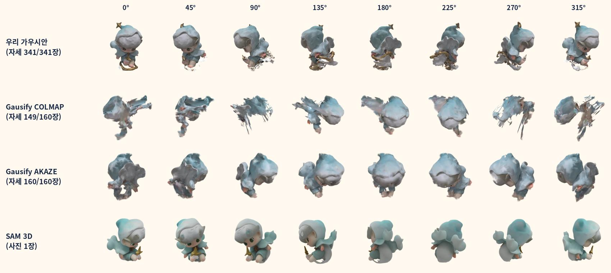
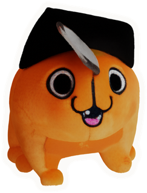
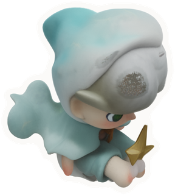
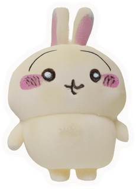

# goodmorning-3d

굿즈를 한 바퀴 찍은 영상(또는 사진) 하나로 3D 에셋을 4가지 방법으로 만들고, 원본 영상과 같은 시점에서 대조해 보는 저장소다.
SAM 3D 결과로는 다꾸용 볼록 스티커(유광)도 만들어 판에 붙여 본다.
굿즈 앱 [goodmorning](https://github.com/bloodmoon3929/goodmorning)의 '내 방' 3D 부분(에셋 · 만드는 코드)을 뷰어와 함께 따로 모았다.

- 뷰어: https://bloodmoon3929.github.io/goodmorning-3d/ — 상단 탭 동영상 1 · 2 · 3(영상마다 3D 4가지) · 스티커
- 쓰는 법: `input/`에 영상이나 사진을 넣고 `./run.sh`



## 쓰는 법

```bash
# 1. input/에 넣는다: 영상(.mp4 .mov …) · 사진 폴더 · 앱 '자동 촬영 가이드'가 내려준 .zip
cp ~/내영상.mp4 input/
# (선택) 같은 이름의 .json으로 이름 · 설정: {"name": "토끼 인형", "prompt": "plush toy", "sam3d_frame": "0440.jpg"}

# 2. 실행 — 하나씩 3D 4가지 + 볼록 스티커 → assets/<id>/ → viewer/data/<id>/, 뷰어 탭(viewer/data/index.json)
./run.sh                    # 이미 만든 결과는 건너뛴다
./run.sh 다른폴더            # input/ 대신
./run.sh --only <id>        # 하나만 · --force 처음부터 · --skip-gausify · --skip-sam3d

# 3. 보기
python3 serve.py            # → http://localhost:8000/viewer/
git add -A && git commit -m "…" && git push   # main에 올리면 GitHub Pages 뷰어도 바뀐다
```

영상 하나에 30~60분쯤 걸린다 (RTX A6000: 우리 가우시안 15분, SAM 3D 1분, Gausify 두 번 10~35분).

처음 한 번 준비할 것

|필요한 것|쓰는 곳|없으면|
|--|--|--|
|[uv](https://docs.astral.sh/uv/), ffmpeg|전부|멈춤|
|NVIDIA GPU + CUDA 12.8 툴킷(`nvcc`)|SAM 3 분할 · SfM · gsplat 학습|멈춤|
|`hf auth login` (facebook/sam3 접근 승인)|SAM 3 분할|멈춤|
|conda 환경 `sam3d-objects` + 가중치 (facebook/sam-3d-objects 승인) — [pipeline/README.md](pipeline/README.md)|SAM 3D Objects · 스티커|그 방법과 스티커만 건너뜀|
|google-chrome (WebGPU)|Gausify Orbit (https://orbit.gausify.com 을 헤드리스로 조작)|그 방법만 건너뜀|

## 영상마다 만드는 3D 4가지

|#|방법|방식|
|--|--|--|
|1|가우시안 스플래팅 (이 저장소)|SAM 3로 굿즈만 분할 → 굿즈 영역의 ALIKED 특징점 · LightGlue 매칭 → COLMAP 카메라 자세 → gsplat 학습 15,000번 → 실루엣 · 떨어진 덩어리 정리|
|2|SAM 3D Objects|굿즈 얼굴이 가장 잘 보이는 사진 1장(SAM 3 'face'로 고름) + 마스크 → 한 번에 3D. 안 찍힌 면은 모델이 추정|
|3|Gausify Orbit — COLMAP 자세|브라우저 WebGPU: 선명한 프레임 160장 → SAM 2.1 분할 → COLMAP SIFT · 전역 매핑 → Brush 학습|
|4|Gausify Orbit — AKAZE 자세 (기본)|위와 같고 자세만 AKAZE 특징점 · 증분 SfM|

분할 프롬프트는 `auto`면 후보("plush toy", "figurine", "toy" …)를 몇 프레임에 물어 가장 확실한 것을 고른다.

## 결과

|영상|1 가우시안 스플래팅|2 SAM 3D|3 Gausify COLMAP|4 Gausify AKAZE|
|--|--|--|--|--|
|동영상 1 포치타 인형 (손에 들고 돌림, 15.8초)|자세 375/380장, PSNR 16.7dB|첫 프레임 1장 — 꼬리 없음|30/160장, 흐린 조각|17/160장, 한쪽 면 조각|
|동영상 2 피규어 (회전판, 26.7초)|자세 341/341장, PSNR 30.2dB|0652.jpg 1장|149/160장 (2조각), 21.0dB|160/160장, 30.4dB|
|동영상 3 토끼 인형 (양손으로 돌림, 34.5초)|자세 208/437장, PSNR 20.2dB|0440.jpg 1장|16/160장 (7조각), 흐린 조각|2/160장 — 만들지 못함|

PSNR은 학습에 쓰지 않은 사진으로 잰 값이다. Gausify는 자세를 찾은 구간 안의 사진으로 재서, 그 구간이 좁으면(동영상 1 · 3) 비교 기준이 되지 않는다.

- 무늬가 있는 피규어를 회전판에 올려 찍은 동영상 2는 네 방법 모두 한 바퀴가 이어졌다
- 손으로 돌린 털 인형(동영상 1 · 3)은 굿즈 표면에서만 특징점을 맞춰야 해서, AKAZE · SIFT(Gausify)는 대부분 이어지지 않는다. 학습된 특징점(ALIKED + LightGlue)은 이어지지만 손이 가린 면은 거칠다
- SAM 3D는 사진 한 장이라 어느 면을 넣느냐에 좌우된다 (토끼 인형 바닥 사진을 넣었을 때는 달걀 모양이 나와서 얼굴 사진을 고르게 바꿨다)

## 스티커

영상마다 만든 SAM 3D 결과를 다꾸용 볼록 스티커로 만들어(`pipeline/sticker.py` → `assets/<id>/sticker.glb`), 뷰어의 스티커 탭에서 판에 붙인다.

  

|만드는 법|내용|
|--|--|
|그림|SAM 3D 가우시안을 입력 사진(굿즈 얼굴이 잘 보이는 사진) 시점에서 그린 색 + 흰 테두리(칼선)|
|볼록함|칼선에서 둥글게 올라오는 돔 + SAM 3D 깊이를 얕게 눌러 담은 부조 (앞으로 나온 곳일수록 높다). 긴 변 6cm, 가장 높은 곳 4.3mm|
|유광|glTF 유광 코팅(`KHR_materials_clearcoat`). 뷰어는 방 환경을 비춰서 판을 기울이면 반사가 움직인다|

스티커 탭에서 할 수 있는 것

- 목록에서 판으로 끌어다 붙이기 (누르면 판 가운데에)
- 스티커를 끌어 옮기기 · ↻ 손잡이로 돌리고 크기 바꾸기 · ×나 Delete 키로 떼기
- 빈 곳을 끌어 판 기울이기 (뒤집히지 않는 범위에서) · 오른쪽 버튼(Shift, 두 손가락)으로 판 옮기기 · 휠(두 손가락 벌리기)로 확대
- 판 처음 자리로 · 모두 떼기

붙인 자리는 저장하지 않는다 (새로고침하면 처음 배치로). 스티커끼리 겹치면 나중에 고른 것이 조금 위에 놓이지만, 볼록한 면이 서로 파고들 수 있다.

## 뷰어

원본 영상과 3D를 나란히 또는 겹쳐 놓고 같은 시점에서 본다.

|방법|3D 카메라|
|--|--|
|1 가우시안 스플래팅|영상 카메라 따라가기: 영상 시간에 맞춰 SfM이 구한 그 프레임의 카메라 자리에서 그린다 (사이 프레임은 보간)|
|2 SAM 3D|입력 사진 시점: 그 사진의 시간에서만 원본과 맞는다 (초점거리는 입력 마스크에 맞춘 값)|
|3 · 4 Gausify|카메라 정보가 없어 자유 회전만|

자유 회전은 끌어서 돌리고 휠 · 두 손가락으로 확대한다. 재생 속도 0.25× · 0.5× · 1×, 겹쳐 보기 3D 진하기, 방법별 결과 표(방식 · 입력 · 자세 · 가우시안 수 · PSNR · 걸린 시간 · 파일)와 비교 그림이 있다. 만들지 못한 방법은 이유를 보여 준다.
`python -m http.server`는 Range 요청을 받지 않아 영상 시간 이동이 안 되므로 `serve.py`를 쓴다. WebGL2가 되는 브라우저가 필요하다.

## 들어 있는 것

```
input/                         원본 영상 (+ 같은 이름의 .json 설정)
assets/<id>/
  gs.ply                       1 가우시안 스플래팅 (SfM 좌표)
  sam3d.ply                    2 SAM 3D (입력 사진의 카메라 좌표) · sam3d_input/ 넣은 사진과 마스크
  gausify_colmap.ply · gausify_akaze.ply · gausify_*.log · gausify.json   3 · 4 Gausify
  sfm/                         COLMAP 모델 (영상 프레임의 카메라 · 점) — gs.ply와 같은 좌표
  turntable/<방법>/             같은 렌더러로 5°씩 72장 · compare.jpg 비교 그림
  methods.json · run.json      방법 · 수치 설명, 실행 기록
  sticker.glb · sticker.png · sticker.json   SAM 3D로 만든 볼록 스티커 · 목록 그림 · 수치
pipeline/                      만드는 코드 (Python, uv) — pipeline/README.md
viewer/                        웹 뷰어 (three.js + Spark, 빌드 없음) · data/<id>/ 뷰어 데이터 · sticker.js 스티커 탭
run.sh                         input/ → 3D 4가지 + 스티커 → 뷰어
serve.py                       뷰어를 이 PC에서 여는 정적 서버 (영상 seek에 필요한 Range 지원)
```

id는 파일 이름에서 만든다 (동영상 1만 `pochita`). .ply는 3D 가우시안 스플래팅 표준 형식이라 [SuperSplat](https://superspl.at/editor) 같은 다른 뷰어에서도 열린다.

## 배포

`main`에 올리면 GitHub Actions(`.github/workflows/pages.yml`)가 `viewer/`와 뷰어가 쓰는 `assets/` 파일(3D · 회전 렌더 · 비교 그림 · 스티커)만 모아 GitHub Pages로 올린다 (SAM 3D는 원본 .ply 대신 `viewer/data/<id>/sam3d.splat`).

## 쓴 것 · 라이선스

- 뷰어: [three.js](https://threejs.org) 0.178.0 (MIT — GLTFLoader · RoomEnvironment 포함), [Spark](https://sparkjs.dev) 0.1.10 (MIT) — `viewer/vendor/`에 함께 넣었다 (외부 CDN을 쓰지 않음)
- 3D: SAM 3 · SAM 3D Objects (Meta, SAM License), gsplat (Apache-2.0), kornia ALIKED · LightGlue (Apache-2.0), COLMAP / pycolmap (BSD-3-Clause), Gausify Orbit (MIT, 웹 서비스로 사용), Playwright (Apache-2.0)
