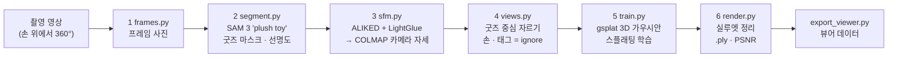

# pipeline — 굿즈 360° 영상 → 3D 에셋

손에 들고 한 바퀴 돌려 찍은 굿즈 영상 하나로 3D 가우시안 스플래팅 에셋을 만들고, 비교용 결과(SAM 3D · Gausify)와 함께 뷰어 데이터를 내보낸다.
GPU(CUDA)가 있는 PC에서 미리 돌리는 오프라인 작업이다. [goodmorning](https://github.com/bloodmoon3929/goodmorning)의 `backend/ai/asset3d`를 옮겨 온 것이다.



## 실행

```bash
cd pipeline
# 경로에 공백이 있으면 gsplat CUDA 컴파일의 링크가 깨진다 → 가상환경을 공백 없는 곳에
export UV_PROJECT_ENVIRONMENT=$HOME/.cache/goodmorning-asset3d-venv CUDA_HOME=/usr/local/cuda-12.8 PATH=/usr/local/cuda-12.8/bin:$PATH
uv sync                        # Python 3.12, torch 2.8 (CUDA 12.8), SAM 3, gsplat, kornia, pycolmap
hf auth login                  # SAM 3 가중치(facebook/sam3)는 접근 승인을 받은 계정이어야 받아진다
A=../assets/pochita

uv run python frames.py ../capture/pochita/20261123_091242.mp4   # → work/frames (앱 촬영 가이드 zip · 사진 폴더도 된다)
uv run python segment.py                                          # → work/masks, masks.json
uv run python sfm.py                                              # → work/sfm (가장 큰 모델: work/sfm/best.txt)
uv run python views.py --count 160                                # → work/views
uv run python train.py --steps 15000                              # → work/gaussians.pt
uv run python render.py --out work/turn --ply $A/gs.ply           # 정리한 3D 파일 · 확인용 PSNR
cp "$(cat work/sfm/best.txt)"/*.bin $A/sfm/                       # 뷰어가 영상 시간에 맞춰 쓰는 카메라

# 비교: 같은 렌더러 · 같은 카메라 경로로 72장씩 → 비교 그림
uv run python render_ply.py $A/gs.ply --out $A/turntable/gs --cams work/views/cams.json
uv run python render_ply.py $A/sam3d.ply --out $A/turntable/sam3d --toward-origin --up 0 1 0
uv run python compare.py --row "우리 가우시안 (자세 375/380장)" $A/turntable/gs --row "SAM 3D (사진 1장)" $A/turntable/sam3d --cell 180 --out $A/compare.jpg

# 뷰어 데이터: viewer/data/pochita/ (manifest.json · 웹용 영상 · SAM 3D .splat)
uv run python export_viewer.py --id pochita
```

`work/`는 저장소에 올리지 않는다. gsplat은 처음 실행할 때 CUDA 코드를 컴파일한다 (2분 안팎, `nvcc` 필요). `export_app.py` · `export_compare.py`는 goodmorning 앱 에셋(`frontend/assets/room/<id>/`)으로 내보내는 스크립트다.

## 단계별로 한 일

|단계|하는 일|정한 것 · 이유|
|--|--|--|
|frames|ffmpeg로 가로 720px 프레임|이 영상은 30fps 가변이고 ffmpeg가 120fps로 뽑아 같은 프레임이 4장씩 생긴다. 프레임 N = (N−1)/120초 (뷰어가 이 시간으로 영상과 맞춘다)|
|segment|프레임마다 SAM 3에 "plush toy"로 물어 가장 점수 높은 영역 1개|손 · 종이 태그는 이 프롬프트에 잡히지 않는다. 흐린 프레임을 거르려고 마스크 안 라플라시안 분산(선명도)도 잰다|
|sfm|마스크 안에서만 ALIKED 특징점 → LightGlue 매칭 → COLMAP 기하 검증 · 증분 복원|손으로 돌리면 배경은 굿즈와 따로 움직여서 굿즈만 보고 맞춘다 ("굿즈는 그대로, 카메라가 주위를 돈다"). 짝은 영상 순서로 가까운 10장 + 16 · 32장 뒤 + 8장마다 고른 프레임끼리 전부(한 바퀴 돌아 처음과 이어지게)|
|views|SfM에 들어간 프레임 중 160장을 고르게, 굿즈 중심 정사각형 512px. 배경은 흰색|자르면서 초점거리 · 중심점도 같이 옮긴다. SAM 3로 "hand" · "paper tag"도 찾아 굿즈를 가린 곳은 ignore|
|train|gsplat, 15,000번. 손실 = 색 L1 0.8 + SSIM 0.2 + 윤곽(alpha ↔ 마스크) 0.5, ignore는 빼고|ignore를 빼지 않으면 손이 가린 자리가 "비어 있음"으로 학습되어 구멍이 생긴다. 8장마다 1장은 학습에 안 쓰고 확인용|
|render|학습 사진에서 마스크 밖에 놓이는 비율이 25% 넘는 가우시안 · 너무 큰 조각을 지우고, 서로 붙어 있는 가장 큰 덩어리만 남긴다|가장자리의 반투명 "지느러미"와, 카메라 가까이에 생긴 작은 복사본 덩어리를 지운다. 확인용 사진은 정리에도 쓰지 않고 PSNR만 잰다|
|export_viewer|방법마다 물체 중심 · 위쪽 · 정면을 구해 뷰어 좌표(중심 = 원점, 위 = +Y, 반지름 1)로 옮기는 행렬, SfM 카메라 375개(영상 시간 · 위치 · 회전), SAM 3D 입력 사진 시점|SAM 3D는 입력 사진의 카메라 좌표(x 왼쪽 · y 위 · z 앞)로 나온다. 초점거리는 가우시안을 입력 마스크에 투영해 가장 잘 겹치는 값(1,090px, IoU 0.85). Gausify는 카메라 정보가 없어 .ply 머리의 `Vertical axis`만 쓴다|

## 이 영상의 결과 (포치타 인형)

|단계|결과|
|--|--|
|영상|15.8초, 1080×1920 HEVC, 30fps 가변 (프레임 475장 → 120fps로 1,900장)|
|SAM 3 분할|2프레임마다 950장 중 896장에서 인형을 찾음|
|SfM|흐린 프레임을 뺀 380장 중 375장이 한 모델로 이어짐 (재투영 오차 1.1px, 점 5,861개). 영상 처음과 끝이 이어져 한 바퀴|
|학습|160장 중 140장으로 15,000번, 가우시안 22.9만 개|
|정리|실루엣 검사 · 가장 큰 덩어리만 → 11.0만 개. 확인용 20장 PSNR 정리 전 18.3dB → 정리 후 16.7dB|

정면 얼굴 · 톱 · 꼬리는 알아볼 수 있지만, 옆 · 뒤 가장자리에 반투명 잡티가 남고 손에 닿았던 바닥은 거칠다. 같은 영상에서 SfM은 실행마다 조금씩 달라서 PSNR도 1~2dB 흔들린다.

## 비교: SAM 3D Objects (사진 1장 → 3D)

같은 영상의 첫 프레임(0001) 한 장과 SAM 3 마스크(`assets/pochita/sam3d_input/`)를 넣었다.

```bash
# SAM 3D Objects 전용 환경 (한 번만): ~/sam-3d-objects, conda env sam3d-objects — 그 저장소 doc/setup.md
#   pypi.ngc.nvidia.com에 닿지 않는 네트워크에서는 PIP_EXTRA_INDEX_URL에서 빼고 설치한다 (cu121 PyTorch 저장소만)
#   가중치: huggingface.co/facebook/sam-3d-objects 접근 승인 후 checkpoints/hf (13GB)
conda run -n sam3d-objects python sam3d.py --image $A/sam3d_input/0001.jpg --mask $A/sam3d_input/0001_mask.png --ply $A/sam3d.ply
```

||가우시안 스플래팅|SAM 3D Objects|
|--|--|--|
|입력|영상 프레임 140장 (+ 확인용 20장)|사진 1장 + 마스크|
|걸린 시간 (A6000)|분할 · SfM · 학습 · 렌더 합쳐 약 15분|모델 불러오기 30초 + 추론 54초|
|가우시안|11.0만 개 (색 SH 3차)|87.8만 개 (색 SH 0차)|
|찍힌 면|실제 모양 (톱 · 꼬리 · 태그까지), 가장자리 잡티|입력 사진 쪽은 깨끗|
|안 찍힌 면|영상에 있으면 실제대로|모델이 추정 — 꼬리가 없고 톱 모양 · 몸통 비율이 실제와 다름, 색이 더 진함|

## 비교: Gausify Orbit (같은 영상)

[Gausify Orbit](https://github.com/obraia/gausify-orbit) (MIT)는 브라우저(WebGPU)에서 둘레 영상 → 선명한 프레임 160장 → SAM 2.1 분할 → 카메라 자세(AKAZE 또는 COLMAP) → Brush 학습까지 하는 도구다. 분할 SAM 2.1, "Also use the cutout for poses" 켬(손으로 돌려서 배경으로는 자세를 못 구한다), Closed orbit(360°) 켬, Balanced(15,000번)로 돌려 받은 .ply가 `assets/pochita/gausify_*.ply`다.

|자세 추정|자세를 찾은 프레임|학습 · 확인용 PSNR|걸린 시간|결과|
|--|--|--|--|--|
|Gausify AKAZE (기본)|17/160|15장 · 2장 36.7dB|14분 (프레임 2 · 분할 1.5 · 자세 4 · 학습 6)|한쪽 면 조각 (2.9만 개)|
|Gausify COLMAP (SIFT · 전역 매핑)|30/160 (8조각 중 가장 큰 것)|28장 · 2장 21.9dB|자세 2.5분 + 학습 7분|흐린 조각 (5.6만 개)|
|이 파이프라인 (ALIKED + LightGlue)|375/380|140장 · 20장 16.7dB|약 15분|한 바퀴 전체 (11.0만 개)|

Gausify의 PSNR은 확인용 2장이 자세를 찾은 좁은 구간 안에 있어서 높게 나온 값이라 비교 기준이 되지 않는다. 이 영상에서 막히는 곳은 학습이 아니라 카메라 자세다. 손으로 돌린 털 인형은 굿즈 안에서만 특징점을 맞춰야 하는데, AKAZE · SIFT는 털 표면에서 프레임끼리 이어지지 않는다. 굿즈를 받침에 세우고 카메라가 도는 촬영이면 배경도 자세 추정에 쓸 수 있다.

```bash
# 회전 렌더: 위쪽 = .ply 머리의 'Vertical axis' 주석, 정면 = 그 축과 x축의 외적 (정면 기준이 없어 임의)
uv run python render_ply.py $A/gausify_colmap.ply --out $A/turntable/gausify_colmap --up 0.2736716 -0.6642369 -0.6956244 --front 0 -0.7232 0.6906
```

- 브라우저가 HEVC 영상을 못 읽어서 H.264로 바꿔 넣었다 (`ffmpeg -i in.mp4 -c:v libx264 -preset medium -crf 16 -pix_fmt yuv420p -an out.mp4`)
- 헤드리스 Chrome은 `--enable-unsafe-webgpu --enable-features=Vulkan,VulkanFromANGLE --use-angle=vulkan --use-gl=angle --disable-vulkan-surface --disable-gpu-sandbox --ignore-gpu-blocklist`를 줘야 WebGPU가 NVIDIA GPU를 잡았다 (없으면 CPU의 SwiftShader)

## 해 봤지만 쓰지 않은 것

|방법|결과|
|--|--|
|VGGT로 카메라 추정|배경을 지운 굿즈 사진 120장에서 신뢰도가 거의 최저로 나왔고, 그 자세로 학습하니 확인용 PSNR 12.6dB로 모양이 깨졌다|
|COLMAP 기본(SIFT)|털 인형이라 특징점이 약해서 한 모델로 이어지지 않고 4조각(최대 76장, 회전 55°)으로 끊겼다|

## 한계

- 손바닥에 닿아 있던 바닥면과, 손으로 쥐어 눌린 부분은 덜 정확하다. 인형은 쥐면 모양이 조금 바뀌어서(딱딱한 물체가 아님) 가장자리에 잡티가 남는다
- 실제 크기(치수)는 모른다

## 쓴 것 · 라이선스

SAM 3 · SAM 3D Objects (Meta, SAM License — 가중치는 접근 승인 필요) · gsplat (Apache-2.0) · kornia ALIKED · LightGlue (Apache-2.0) · COLMAP / pycolmap (BSD-3-Clause) · PyTorch
